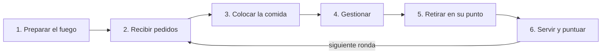

# Core loop

Lo que el jugador hace una y otra vez. **Si este bucle es divertido con cubos grises, el juego funciona.**

| # | Paso | Qué hace el jugador |
|---|---|---|
| 1 | 🔥 **Preparar el fuego** | Carbón / leña / gas, encender, esperar a que se haga brasa |
| 2 | 🧾 **Recibir pedidos** | Los invitados piden: chuletón al punto, chorizo, verduras… |
| 3 | 🥩 **Colocar la comida** | Elegir zona: directa (fuerte) o indirecta (suave) |
| 4 | 🍳 **Gestionar** | Girar, mover, salar, tapar, controlar llamaradas |
| 5 | 🌡️ **Retirar en su punto** | Termómetro, color, sonido; reposo |
| 6 | ⭐ **Servir y puntuar** | Propinas, estrellas, desbloqueos |

El fuego se prepara una vez. Luego se repite el bucle **2 → 6** en cada ronda.

Sistemas que lo hacen posible: [[Arquitectura]]. Detalle de cada acción: [[Mecánicas]].

![[figjam-1-core-loop.webp]]
