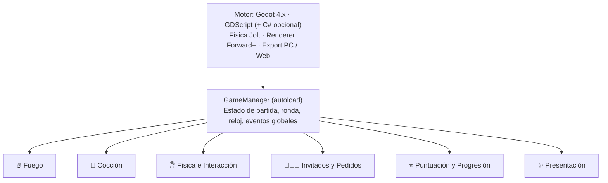

# Arquitectura

Cada sistema es una **escena/nodo independiente** en Godot que se comunica por **señales**. Los datos (alimentos, parrillas, recetas) viven en **Resources editables** sin tocar código.

## Sistemas

### 🔥 Sistema de Fuego
- Combustible: carbón, leña, gas
- Temperatura por zonas (rejilla de celdas de calor) → hecho en la F1: `RejillaCalor`, 8×4 celdas ([[2026-11-22 Rejilla de calor por celdas]])
- Brasas vivas (F2, en `dev` sin commit): cada celda tiene `carbon` y `fuego`; calor = fuego × min(1, carbón × 2). Funciones `echar_carbon`, `avivar`, `encender_dos_zonas`, `carbon_total` y `calor_medio`; export `empezar_encendida`. Brasas visibles con un MultiMesh y el shader `shaders/brasas.gdshader`; la rejilla se dibuja con barras (`crear_barras`) → [[2026-11-25 Encendido con chimenea y abanico]]
- Objetos de encendido: `chimenea_encendido`, `saco_carbon` y `abanico` (escenas en `escenas/fuego/`, scripts en `scripts/fuego/`); leen F ellos mismos mientras se llevan → [[2026-11-25 Chimenea y abanico leen F mientras se llevan]]
- Encendido, apagado, viento
- Llamaradas cuando gotea grasa

### 🥩 Sistema de Cocción
- Cada alimento: temperatura interna y superficie por cara → hecho en la F1: `EstadoCoccion` y `TipoAlimento` ([[2026-11-22 Cocción por caras con superficie e interior]])
- Estados: crudo → sellado → al punto → pasado → quemado
- Shader que mezcla texturas según cocción
- Tablas de cocción por tipo de carne

### ✋ Física e Interacción
- Primera persona (plantilla [[Juegos de referencia#Cogito|Cogito]])
- Pinzas, espátula, salero, tapa
- RigidBody + Jolt para coger, girar, tirar
- Raycast para apuntar

### 🧑‍🤝‍🧑 Invitados y Pedidos
- Cola de pedidos con punto deseado
- Paciencia / humor de cada invitado
- NPCs low-poly con animaciones simples
- Idea para más adelante: un perro callejero como NPC → [[Perro callejero]]

### ⭐ Puntuación y Progresión
- Nota por punto, tiempo y presentación
- Dinero → nuevas parrillas, utensilios, recetas (idea: [[Ruta de mejora de la limpieza]], trapo → cepillo → mocho)
- Modo carrera + modo libre (sandbox)

### ✨ Presentación
- VFX: GPUParticles3D (humo, brasas, chispas)
- Audio: chisporroteo según temperatura
- HUD: termómetro, pedidos, tutorial

## Capa de datos
- 📦 **Datos** (Resources `.tres`): alimentos, parrillas, combustibles, recetas, niveles
- 💾 **Guardado**: JSON / ConfigFile

Relacionado: [[Stack]], [[Core loop]], [[Skills de Claude]]

![[figjam-2-arquitectura.webp]]
